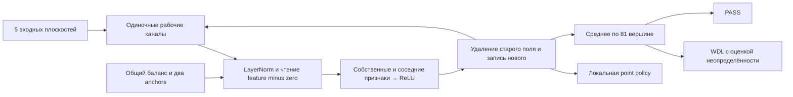

# WSP v002: анализ и новая организация вычислений

## Вывод аудита v001

Узкое место v001 — размещение промежуточных результатов, а не число параметров
GraphNet. 59 пар занимают 118 каналов; ещё два нужны для стабилизации LayerNorm.
Каждый результат навсегда занимает пару, даже если его следующий потребитель уже
отработал. Из-за ограничения `birth[destination] == block` нельзя изменить
существующую величину. Поэтому ещё один этап распространения признака требует
нового регистра. 84 ReLU — следствие этой конкретной программы, не аппаратный
предел: компилятор разрешает 120 на блок, но сохранять новые результаты негде.

В 84 входят также вторые ReLU кусочно-линейных рамп. Это число задействованных
строк матриц, а не число фактически положительных активаций на каждой доске.
Пары дают полезные свойства: нулевое среднее, подавление общего сдвига LayerNorm,
сохранение знака после финального ReLU с общим offset. Отказ от них требует
замены этих свойств, а не простого удаления каждого второго канала.

Недоиспользованы:

- 876 из 960 промежуточных ReLU, возможность суммирования многих базисных функций
  в один выход и широкое смешивание каналов;
- residual как преобразование состояния, а не только дописывание;
- непрерывные величины и несколько пространственных масштабов одновременно;
- нелинейность WDL-головы для зависимости уверенности от неопределённости позиции.

Структурный подсчёт (`parameter-audit.json`): trunk содержит 350 400 параметров,
value head — 14 883. Ещё 29 524 принадлежат ownership/score: в данном `forward`
они вообще не влияют на игровую policy/WDL. Заполнение этих вспомогательных
голов не может усилить игру без изменения контракта архитектуры. Поэтому
396 009 нельзя трактовать как полностью взаимозаменяемый вычислительный бюджет.

Количество весов между MLP и GraphNet напрямую не сравнимо. Здесь одни веса
работают на 81 вершине: 84 строки означают 6 804 потенциальных ReLU-вычисления
на доску. В первичном [описании MIT](https://rikiyat.github.io/blog/weight-space-programming/)
Go-эксперимент использует MLP 243→512×6→82 и другую игру/оценку. Это мотивация
исследовать ёмкость, но не количественный ориентир силы Torus9.

## Ограничения самой GraphNet

Восемь блоков дают восемь переходов по графу. Диаметр полного тора 9×9 равен
восьми, но путь по связной группе с препятствиями может быть намного длиннее.
Достижимость по всему графу не означает знание связности по камням одного цвета.
Усреднение четырёх соседей сохраняет перестановочную симметрию и не сообщает,
какой из них находится в конкретном направлении. Нельзя без дополнительных
вычислений различить повторное свидетельство одного дамэ и несколько разных.

Point policy не получает global pooling обратно: глобальные нелинейные
вычисления WDL недоступны каждому point logit. PASS — одна линейная функция
усреднённых последних признаков; её нелинейные условия надо подготовить в trunk.
В пяти входных плоскостях нет полной superko-истории и нет отдельного коми.
Стандартный legal mask учитывает правила; коми 1,5 зафиксировано в программе.
Лестницы, сэки, различение групп с одинаковыми локальными сообщениями и точное
число уникальных дамэ произвольной группы эта реализация не решает.

## Компилятор v002

Вместо 59 пар используются до 116 одиночных каналов. Канал 116 хранит минус сумму
всех признаков; канал 117 — нулевую опору; 118–119 — противоположные anchors.
Любое входное или residual-изменение компенсируется в общей суммирующей полосе.
Чтение `feature - zero` подавляет остаточную ошибку среднего LayerNorm. Anchors
±2²⁰ и gamma = 2²⁰/√60 делают нормализацию близкой к единичной. Это всё те же
линейные матрицы и LayerNorm исходной модели, без дополнительного runtime.

`replace(name)` реализует `x ← x - ReLU(x) + f(old_state)` для неотрицательных
рабочих полей. Все чтения блока относятся к состоянию до блока. Отрицательное
значение потребовало бы двух ReLU для удаления; в текущей программе заменяются
только неотрицательные поля. Суммы многих hinge-функций записываются в общий
канал полезности, вместо отдельного регистра для каждой функции.

Финальный offset обычно равен 2. Только знаковая `shape` получает ещё 32 с точной
компенсацией в policy bias. Это уменьшает FP32-вычитание больших почти одинаковых
констант. Первый вариант с общим offset 32 не прошёл заранее заданный тест
CPU/CUDA (0,002441 > 0,002); его checkpoint и отрицательный отчёт сохранены.

## Содержательные вычисления

1. Блок 0: соседние количества, прямые дамэ, пять категорий степени вершины для
   каждого цвета, начальные поля и исключение бездамных листьев.
2. Блоки 1–5: многократно используемые свидетельства ≥2/≥3 дамэ и leaf peeling;
   три степени затухания (0,35/0,65/0,9) доступа к свободе и пространственного
   влияния; ограниченная связная масса. Категории степени реализуют аналитическое
   деление на число соседей того же цвета при распространении доступа к дамэ.
3. В пространственных полях свои камни фиксированы в 1, чужие в 0; пустые пункты
   получают затухающую среднюю соседей. Это приближённая граничная задача,
   выполняемая пятью шагами, а не внешний расчёт территории.
4. Блоки 5–6: доказанное атари отделено от неопределённого риска; три оценки
   территории, угрозы, связная масса под риском, соединение/разделение,
   насыщаемые функции полезности пространства.
5. Блок 7: допустимые спасение/ранняя защита, распространение риска к ходам,
   нелинейная поверхность безопасности продолжения и наличие ещё полезных ходов.
6. WDL: оценка area margin и дополнительная уверенность лишь когда margin
   превосходит неопределённость пустых пунктов и слабых групп. Это аналитическая
   эвристика, **не статистически калиброванная вероятность победы**.

Доказательства ≥2/≥3 и закрытого атари остаются достаточными, но неполными.
Остальные сигналы намеренно приблизительны. `mass` не считает уникальные камни;
`connection` не считает разные группы; диффузионный доступ к свободе не равен
точному числу дамэ. Они должны оправдать себя партиями.

Дополнительное ограничение, обнаруженное статическим разбором после фиксации:
`mass = clip(8*color + 0.5*sum_neighbor_mass - 7, 0, 8)` не обеспечивает строгую
изоляцию по цвету при больших значениях соседей. При `color=0` и четырёх соседях
со значением 8 получается 8, а не 0. Поэтому поле может переходить через пустые
или чужие пункты; термин «связная масса» описывает намерение, а не гарантию.
Это конкретная слабость новой эвристики. Финальный checkpoint не исправлялся
после freeze; причинное влияние этой особенности на итоговый счёт не измерено.

В финальном варианте 92 именованных канала, 561 из 960 ReLU
(`[53,78,82,82,82,104,48,32]`) и 5 195 ненулевых параметров. По сравнению с v001
это 6,68× строк ReLU и 2,48× коэффициентов, при тех же 396 009 параметрах.
Часть дополнительных коэффициентов обслуживает кодирование и перезапись;
эти множители **не означают** аналогичного роста полезной сложности или силы.
Намеренного заполнения неиспользуемых матриц нет.

## Что показала разработка

До фиксации итогового кандидата были восемь отдельных игровых проходов. Полная
история, включая неудачи, остаётся в `session64/rounds`:

| Вариант | Режим | W–L против v001 | Интерпретация |
|---|---|---:|---|
| initial | policy | 0–8 | первая организация полей; ошибка знака пространственной функции |
| degree | policy | 4–28 | деление сообщений по степени, исправление знака |
| space | policy | 0–32 | усиленное рассредоточение ухудшило игру |
| opportunity | policy | 4–28 | учёт наличия безопасных ходов в PASS недостаточен |
| balanced | policy | 15–17 | умеренное влияние новых стратегических признаков |
| balanced | MCTS-64 | 0–8 | слабость оценки позиции при поиске |
| harmonic | policy | 13–19 | другая половина development-набора |
| harmonic | MCTS-64 | 5–3 | перспективный, но очень малый диагностический результат |

Это не независимые финальные оценки, разные строки используют неодинаковые
начала и не устанавливают причинность отдельных изменений. Веса не подгонялись
регрессией, оптимизатором или автоматическим поиском коэффициентов; менялись
аналитические программы после разбора поведения. Все семь checkpoints созданы
от независимых нулевых genesis; старые веса не импортировались в compiler.

Для независимой оценки выбран `harmonic-stable`: алгебраически та же программа,
что `harmonic`, с уменьшением отмены констант. Уточнение FP32 может изменить
разрешение почти равных ходов, поэтому итоговый checkpoint отдельно фиксируется
хешем и полностью оценивается заново. Результаты см. `RESULTS.md`.
